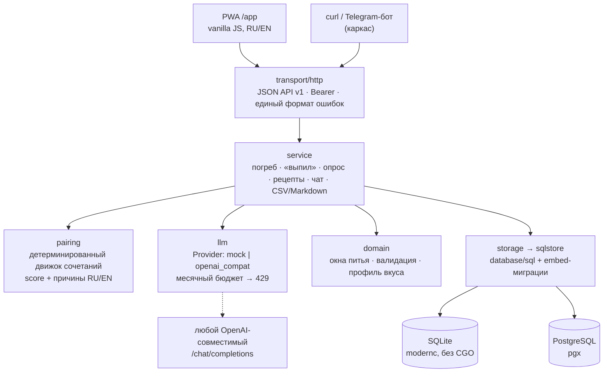

# Terroir

**Персональный винный помощник с памятью** для одного человека или пары. Не сканер этикеток и не «чат, в который загрузили погреб»: в основе — структурированные данные и детерминированная логика, LLM — слой поверх.

- **Погреб** — бутылки, места хранения, окна питья, «выпил» одним тапом с оценкой и заметкой. История не теряется: строка с нулём остаётся.
- **Совместный погреб пары** — общие бутылки и рецепты, у каждого свой профиль вкуса.
- **Профиль вкуса** — короткие опросы пачками по 5–7 вопросов, обновление профиля детерминированное.
- **Свои рецепты** и связка в обе стороны: «что открыть к этому блюду» и «что приготовить к этой бутылке». Удачные пары учат движок.
- **Чат-ассистент** отвечает из *вашего* погреба, профиля и истории и рекомендует только то, что есть.

> **Статус: MVP-ядро** (2026-10). Бэкенд, API, движок сочетаний, LLM-слой и PWA работают на демо-данных. Postgres, Docker и CI написаны, но ещё не прогонялись. Подробно — [`docs/STATUS.md`](docs/STATUS.md).

## Запуск за минуту

Нужен только Go ≥ 1.26. Docker, ключи и сеть не нужны: по умолчанию SQLite и mock-LLM.

```bash
make dev                         # SQLite + демо-данные + mock-LLM на :8080
curl localhost:8080/health       # {"status":"ok","storage":"sqlite","llm_provider":"mock",...}
open http://localhost:8080/app   # PWA; токен: dev-anton-token или dev-elena-token
```

```bash
T="Authorization: Bearer dev-anton-token"
curl -H "$T" localhost:8080/v1/cellar/summary
curl -H "$T" -X POST localhost:8080/v1/chat -d '{"message":"Что открыть к стейку?"}'
# → «К блюду „Стейк рибай“ я бы открыл Каберне Совиньон резерв … 2017 [item:i-cabernet-kuban]. Почему: …»
```

```bash
make test    # все тесты с -race
make lint    # gofmt + go vet
```

Демо-данные вымышленные: дом из двух пользователей, 22 бутылки (в основном Дон, Кубань, Крым, Кахетия), 11 рецептов, история и профили. Все команды, переменные окружения, переключение на реальный LLM и запуск на PostgreSQL — в [`docs/DEVELOPMENT.md`](docs/DEVELOPMENT.md).

## Архитектура

Монолит на Go: стандартный `net/http` (маршруты Go 1.22+), без фреймворков. PWA встроен в бинарь через `embed`, сборки фронтенда нет.



### Как отвечает ассистент

1. Интент определяется по ключевым словам («к стейку», «что купить снова»).
2. Кандидаты подбирают **код**: движок сочетаний, окна питья, профиль и история.
3. LLM получает кандидатов и сжатый погреб и только *формулирует* ответ.
4. Ответ проверяется: каждая бутылка должна быть ссылкой `[item:<id>]` на реальную позицию погреба.
5. Если модель сослалась на несуществующую бутылку, провайдер упал или кончился бюджет — детерминированный ответ с `"fallback": true`.

Так «рекомендует только то, что есть» гарантирует код, а не промпт. Mock выдаёт тот же детерминированный ответ, поэтому демо и тесты осмысленны без ключей.

## Ключевые решения

Полный журнал с альтернативами — [`docs/DECISIONS.md`](docs/DECISIONS.md) (D-001…D-014).

| Решение | Почему |
|---|---|
| Структура первична, LLM — «голос» (D-010) | Ров продукта — данные погреба и своя кухня; ChatGPT с памятью закрывает «просто чат» |
| Одна реализация хранилища на `database/sql`: SQLite для dev и тестов, PostgreSQL для боевого (D-002) | Запуск одной командой без Docker, тот же код в проде |
| Любой OpenAI-совместимый провайдер, mock по умолчанию | Нет привязки к вендору; тесты и демо без сети. Ретраи 429/5xx с backoff и `Retry-After`, белый список заголовков |
| Месячный бюджет LLM в токенах и деньгах, проверка **до** вызова (D-011) | Платит один человек; при превышении `429 llm_budget_exceeded`, учёт в `llm_usage` |
| Правила сочетаний в Go-коде, а не в YAML (D-009) | Типы, табличные тесты, причины рекомендации на RU/EN |
| «Выпил» атомарно, без ухода в минус | Тест: 8–10 параллельных «выпил последней» → ровно один успех |
| Деньги в минимальных единицах, ID — UUID из приложения (D-004) | Без float и без зависимости от БД |
| PWA без сборки, встроенный в бинарь; Flutter — после проверки гипотезы (D-012) | Минимум инфраструктуры на этапе MVP |
| Статические Bearer-токены вместо регистрации (D-007) | Закрытая бета на 2–50 человек |

## API

30 эндпоинтов `/v1`: вина и бутылки (CRUD, фильтры по цвету, стране, сорту, месту, «пора пить»), «выпил», сводка и история, «купить снова», напоминания, опрос и профиль вкуса, рецепты и сочетания в обе стороны, обратная связь по паре, чат, экспорт/импорт CSV, импорт из Markdown-таблицы. Спецификация OpenAPI 3.1 — [`docs/api/openapi.yaml`](docs/api/openapi.yaml), проверенные примеры — [`docs/api/examples.sh`](docs/api/examples.sh).

## Качество

- 92 тест-функции: табличные кейсы движка сочетаний, httptest на каждый эндпоинт, сквозной сценарий «вино → бутылка → выпил → сводка», гонки на последней бутылке, клиент LLM на `httptest`.
- Покрытие: domain 96 % · pairing 98 % · llm 97 % · service 86 % · http 82 % · sqlstore 79 %.
- **10 эталонных вопросов** к ассистенту с проверкой свойств ответа (бутылка есть в погребе, окно питья учтено, отвергнутые сорта не предлагаются) — 10/10 на mock. Тот же набор — для слепого сравнения с универсальным чат-ботом: [`docs/eval/blind-questions.md`](docs/eval/blind-questions.md).
- GitHub Actions: gofmt, go vet, `go test -race`.

## Стек

Go 1.26 · `net/http` · `database/sql` · SQLite (`modernc.org/sqlite`, без CGO) · PostgreSQL (`pgx`) · embed-миграции · `log/slog` · vanilla JS PWA (service worker, manifest) · OpenAI-совместимый LLM API · Docker (distroless) · GitHub Actions.

## Структура

```text
backend/
  cmd/api/              точка входа
  internal/domain/      типы и чистая логика
  internal/service/     сценарии и ассистент
  internal/pairing/     движок сочетаний
  internal/llm/         провайдеры, бюджет, промпты
  internal/storage/     интерфейсы и sqlstore (SQLite | Postgres)
  internal/transport/   HTTP API v1
  internal/webapp/      встроенный PWA
  internal/telegram/    каркас бота
  internal/eval/        эталонные вопросы
docs/                   статус, решения, API, архитектура, разработка
infra/                  init-скрипты PostgreSQL
```

## Что дальше

- Прогнать Postgres-тесты и Docker-сборку, запустить CI.
- Формы добавления бутылок и рецептов в PWA (сейчас — через API и импорт).
- Подключить реального провайдера и прогнать эталонные вопросы на нём.
- Закрытая бета; критерии kill / continue — в [`docs/product/vision-2026-09.md`](docs/product/vision-2026-09.md).
